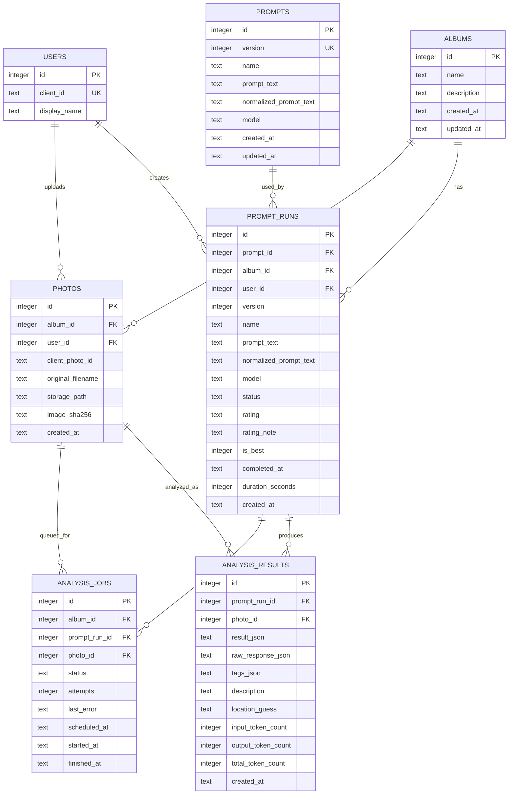

# Disaster Photo AI Tagger

這是由原本單檔 HTML 改成的 Flask + SQLite 版本。Gemini API Key 改由後端 `.env` 管理。資料流以「相簿」為共享單位：一個相簿存同一批照片，一個相簿可建立多個 Prompt Run，Prompt 測試紀錄、JSON 分析結果、Prompt 名稱、評分與評分原因會寫入 SQLite。

頁面預設維持原本的 Prompt + 照片工作區；系統會自動開啟上次使用的相簿，或 DB 內第一個相簿。上方「切換相簿」使用下拉選單切換相簿，新增相簿則以彈出視窗填寫相簿名稱與選填描述。Prompt 版本號以目前相簿為範圍，每個相簿都會從 v1 開始。

## 專案結構

```text
disaster-photo-tagger/
  app/
    main.py
  public/
    index.html
  data/
    app.db
  uploads/
  requirements.txt
  .env.example
  .gitignore
  run.py
```

## 本機啟動

```powershell
cd C:\apps\disaster-photo-tagger
python -m venv .venv
.\.venv\Scripts\activate
pip install -r requirements.txt
copy .env.example .env
```

編輯 `.env`：

```env
PORT=8088
GEMINI_API_KEY=你的 Gemini API Key
GEMINI_MODEL=gemini-2.5-flash
GEMINI_MAX_CONCURRENT=1
GEMINI_MIN_SECONDS_BETWEEN_REQUESTS=6
GEMINI_MAX_RETRIES=3
GEMINI_RETRY_BASE_SECONDS=30
GEMINI_RETRY_MAX_SECONDS=300
DATABASE_PATH=data/app.db
UPLOAD_DIR=uploads
MAX_PHOTOS_PER_ALBUM=50
MAX_UPLOAD_MB=5
MAX_ACTIVE_PROMPT_RUNS=5
QUEUE_WORKER_ENABLED=1
QUEUE_POLL_SECONDS=1
FLASK_SECRET_KEY=請換成隨機字串
```

開發測試：

```powershell
.\.venv\Scripts\python.exe run.py
```

測試機建議用 Waitress：

```powershell
.\.venv\Scripts\waitress-serve.exe --host=127.0.0.1 --port=8088 run:app
```

如果要讓外部使用者連線，建議由 XAMPP Apache 反向代理公開連線，例如：

```text
https://ncdr.info:1115/  ->  http://127.0.0.1:8088/
```

## XAMPP Apache 反向代理

確認 Apache 已啟用：

```apache
LoadModule proxy_module modules/mod_proxy.so
LoadModule proxy_http_module modules/mod_proxy_http.so
LoadModule ssl_module modules/mod_ssl.so
```

`httpd-ssl.conf` 或額外 include 的 conf 可加入類似設定：

```apache
Listen 1115

<VirtualHost *:1115>
    SSLEngine on
    SSLCertificateFile "conf/ssl.crt/server.crt"
    SSLCertificateKeyFile "conf/ssl.key/server.key"

    ProxyPreserveHost On
    ProxyPass / http://127.0.0.1:8088/
    ProxyPassReverse / http://127.0.0.1:8088/
</VirtualHost>
```

## API 檢查

```powershell
curl http://localhost:8088/api/health
```

應回傳：

```json
{"ok": true}
```

## 單元測試

```powershell
.\.venv\Scripts\python.exe -m unittest discover -s tests -v
```

測試會使用專案內 `tests/.tmp/` 的暫存 SQLite 與 uploads，不會呼叫 Gemini API。

## 資料持久化

- SQLite: `data/app.db`
- 上傳圖片: `uploads/`
- 備份時至少備份這兩個目錄。
- 相簿資料: `albums`
- 相簿照片: `photos.album_id`
- 相簿 Prompt Run: `prompt_runs.album_id`
- 分析結果: `analysis_results.prompt_run_id + photo_id`
- `analysis_results` 與 `analysis_jobs` 都以 `UNIQUE(prompt_run_id, photo_id)` 保護，同一個 Prompt Run 的同一張照片不會重複建立結果或 job。
- 照片列表若指定 `prompt_run_id`，會顯示該 Prompt Run 的結果；若未指定，後端預設顯示目前相簿最新建立的 Prompt Run 結果。若要查看其他版本，可從 Prompt 測試紀錄手動載入指定 run。
- 單張重新辨識會覆蓋同一個 Prompt Run + Photo 的舊結果，只保留最新一次；不會自動建立新的 Prompt Run 版本。
- 每個相簿只能標記一個最佳 Prompt Run；標記最佳只會影響同一個相簿。
- 每次 Prompt Run 完成、失敗或取消時，會把耗時秒數寫入 `prompt_runs.duration_seconds`，API 會回傳 `durationSeconds` 與 `completedAt`，前端會在 Prompt 測試紀錄顯示本次辨識耗時。
- 前端不要求填寫使用者名稱，也不會送出使用者名稱；後端保留既有 `users` 資料表只是為了相容既有 SQLite schema。
- `.env`、`data/*.db`、`uploads/`、`.venv/`、`tests/.tmp/` 預設列入 `.gitignore`，不要放進版控或公開部署包。

## ERD 與 Case 對照

目前資料模型的核心觀念是：

- `prompts` 是全站共用的 Prompt 定義，唯一條件是 `normalized_prompt_text + model`。
- `prompt_runs` 是某一本相簿實際執行 Prompt 的版本，Run 版本號範圍是 `album_id + prompt_id + version`。
- `analysis_results` 是某個 Prompt Run 對某張照片的分析結果。
- 同一個 Prompt Text 跑不同相簿，會共用同一筆 `prompts`，但各自建立不同 `prompt_runs` 與 `analysis_results`。
- 同一個 Prompt Text 跑同一本相簿，若既有 run 還在 queued / running，會重用同一個 `prompt_runs`；若既有 run 已 completed，前端會詢問是否建立新版 run。



重要唯一限制：

| 資料表 | 唯一限制 | 目的 |
|---|---|---|
| `prompts` | `normalized_prompt_text + model` | 同一份 Prompt Text 與同一 model 只保留一筆全站 Prompt 定義。 |
| `prompt_runs` | `album_id + prompt_id + version` | 每本相簿內，每一份 Prompt 的 Run 版本各自從 v1 開始。 |
| `photos` | `album_id + client_photo_id` | 同一本相簿內同一張前端照片不重複建立。 |
| `analysis_jobs` | `prompt_run_id + photo_id` | 同一個 Prompt Run 的同一張照片不重複排入 Queue。 |
| `analysis_results` | `prompt_run_id + photo_id` | 同一個 Prompt Run 的同一張照片只保留最新結果。 |

Case 對照：

| Case | 操作 | 最終資料結果 |
|---|---|---|
| A 與 B 用不同 Prompt Text 跑同一本相簿 | `album_id` 相同，`prompt_text` 不同 | 建立不同 `prompts`、不同 `prompt_runs`、不同 `analysis_results`。 |
| A 與 B 用相同 Prompt Text 跑同一本相簿，且 run 仍在 queued / running | `album_id + normalized_prompt_text + model` 完全相同 | 後端重用同一個 `prompt_runs`，兩人看到同一份進度與結果。 |
| A 與 B 用相同 Prompt Text 跑同一本相簿，且既有 run 已 completed | `album_id + normalized_prompt_text + model` 完全相同 | 前端提示是否重跑；取消則載入既有 run，確定則建立新版 `prompt_runs`。 |
| Prompt X 在相簿 1 已跑兩次，接著編輯成 Prompt Y 再跑 | Prompt X 與 Prompt Y 會是不同 `prompt_id` | Prompt X 會有 Run v1、Run v2；Prompt Y 的第一個 run 會是 Run v1。 |
| A 用 Prompt X 跑相簿 1 與相簿 2 | `prompt_text` 相同，`album_id` 不同 | 共用同一筆 `prompts`，但相簿 1 與相簿 2 各自建立 `prompt_runs` 與結果。 |
| A 跑相簿 1、2，B 也用 Prompt X 跑相簿 1 | 相簿 1 的 Prompt X 已存在，且相簿 2 是另一個 `album_id` | 最終是兩份相簿結果：相簿 1 一份、相簿 2 一份；B 的相簿 1 會重用相簿 1 的既有 run。 |
| 從 Prompt 測試紀錄載入 V1 | 指定 `prompt_run_id` | 照片列表顯示 V1 的結果，不會自動切到最新 run。 |
| 載入 V1 後單張重新辨識 | `preferred_run_id = V1` 且 `replace_existing_jobs = true` | 重排 V1 + 該照片的 job，完成後覆蓋同一筆 V1 結果，不建立 V2。 |

## 多使用者與 Queue

目前版本的前端會把 Prompt Run 送入後端 Queue，由背景 worker 控制 Gemini API 的全站併發與呼叫間隔。舊的同步 `/api/albums/<album_id>/analyze` API 仍保留作為相容用途，但主要頁面已改用 Queue 流程。

Queue 架構：

```text
使用者建立 Prompt Run
-> 後端依照片產生多筆 analysis_jobs
-> Worker Pool 控制全站 Gemini API 併發數
-> Queue 以不同 Prompt Run 公平輪詢
-> 前端 polling 查詢進度與結果
```

目前第一版使用 SQLite 管理 job queue，不必先導入 Redis、RabbitMQ 或 Celery。等到使用人數、失敗重試、排程可靠性或多台機器部署需求變高，再升級成專用 queue 服務。

目前限制可由 `.env` 調整：

- `MAX_PHOTOS_PER_ALBUM`: 每本相簿最多照片數，預設 50。
- `MAX_UPLOAD_MB`: 每張照片最大 MB，預設 5。
- `MAX_ACTIVE_PROMPT_RUNS`: 全站最多 queued / running Prompt Run 數，預設 5。
- `GEMINI_MAX_CONCURRENT`: 全站 Gemini API 同時呼叫數，預設 1。
- `GEMINI_MIN_SECONDS_BETWEEN_REQUESTS`: Gemini request 最小間隔秒數，預設 6。
- `GEMINI_MAX_RETRIES`: 每個 job 最大重試次數，預設 3。
- 同一個 Prompt Run 同一時間只能有一個 active execution。
- 同一個 Prompt Run + Photo 的結果只保留最新一次。
- 每筆分析結果會記錄 Gemini `usageMetadata` 內的 input / output / total token。
- 遇到 Gemini `429`、timeout 或暫時性錯誤時，job 應延遲重試，不要立即永久失敗。

Queue 資料表：

```text
analysis_jobs
- id
- album_id
- prompt_run_id
- photo_id
- status: queued / running / completed / failed / cancelled
- attempts
- last_error
- scheduled_at
- started_at
- finished_at
- created_at
```

## Queue Use Cases

### Use Case 1: 不同使用者用不同 Prompt 跑同一本相簿

情境：

```text
使用者 A 對相簿 1 建立 Prompt Run V1
使用者 B 對相簿 1 建立 Prompt Run V2
兩人的 prompt text 不同
```

目前行為：

```text
V1 與 V2 都會建立各自的 analysis_jobs
Queue 不會讓 V1 的 50 張全部跑完才輪到 V2
Worker 會在不同 Prompt Run 之間公平輪詢
```

範例順序：

```text
V1 Photo 1
V2 Photo 1
V1 Photo 2
V2 Photo 2
...
```

### Use Case 2: 不同使用者送出完全相同 Prompt

情境：

```text
使用者 A 對相簿 1 送出 prompt text = "請辨識災害類型"
使用者 B 對相簿 1 也送出完全相同 prompt text 與相同 model
V1 尚在 queued 或 running
```

目前行為：

```text
後端不建立新的 Prompt Run
直接回傳既有 Prompt Run ID
使用者 B 看到與使用者 A 相同的執行進度與結果
```

目前判斷條件：

```text
album_id + normalized_prompt_text + model
```

`normalized_prompt_text` 會移除前後空白並整理多餘換行，避免只是空白不同就建立重複 Prompt Run。若只是修改標點符號或改寫文字，仍會被視為不同 Prompt。

### Use Case 3: 相同 Prompt 已完成後再次執行

情境：

```text
相簿 1 已有 Prompt Run V1
V1 使用相同 prompt text 與 model
V1 狀態已 completed
使用者再次按下「用這個 Prompt 辨識全部照片」
```

目前行為：

```text
前端會提示已存在相同 Prompt 的完成結果
按「取消」會直接載入既有結果，不自動重跑
按「確定」會以 force_rerun 建立新的 Prompt Run 版本並重新分析
```

這可以避免同一份 prompt 因誤按而重複消耗 Gemini API quota。

如果使用者是從「Prompt 測試紀錄」的某一版載入 Prompt 內容，系統會記住該 Prompt Run 版本。當同一份 prompt 已有多個完成版本時，按「取消」不重新分析會優先載入使用者選擇的那一版結果，而不是自動載入最新版本。

### Use Case 4: 從 Prompt 測試紀錄載入指定結果

情境：

```text
相簿 1 有 Prompt Run V1 與 V2
使用者在 Prompt 測試紀錄中按 V1 的「載入這次結果」
```

目前行為：

```text
前端會把 V1 設為 preferredPromptRunId
「載入這次結果」按鈕會顯示已載入狀態
照片列表會呼叫 /api/albums/<album_id>/photos?prompt_run_id=<V1 run id>
下方照片卡片顯示 V1 的 tags、描述、座標與 JSON 結果
```

如果沒有指定 `prompt_run_id`，照片列表預設會使用目前相簿最新建立的 Prompt Run。最佳 Prompt Run 仍會以標籤方式保留在 Prompt 測試紀錄中，但不會自動覆蓋預設載入規則；使用者可手動按「載入這次結果」切換到最佳或其他版本。

### Use Case 5: 單張照片在指定 Prompt Run 內重新辨識

情境：

```text
使用者先載入 Prompt Run V1 的結果
對相簿內單張照片按「重新辨識」
```

目前行為：

```text
前端送出 preferred_run_id = V1
前端送出 replace_existing_jobs = true
後端重排 V1 + 該照片的 job
完成後覆蓋同一筆 analysis_results
不會建立新的 Prompt Run 版本
```

因此單張重新辨識是「更新同一版 Prompt Run 的該張照片結果」，不是建立 V2。

### Use Case 6: 同一個 Prompt 套用多個相簿

情境：

```text
使用者選用或編輯同一份 Prompt
在辨識範圍中勾選目前相簿與其他相簿
按下「用這個 Prompt 辨識全部照片」
```

目前行為：

```text
目前相簿會使用畫面上的照片清單送入 Queue
其他相簿會先讀取該相簿已儲存照片，再送入 Queue
每個相簿各自建立或重用自己的 Prompt Run
同一個全站 Prompt 可以對應多本相簿的多個 Prompt Run
```

Prompt 測試紀錄可以切換「只看目前相簿」或「全部相簿」，用來查看同一個 Prompt 在不同相簿上的分析結果。

### Use Case 7: 同一個 Prompt Run 被重複觸發

情境：

```text
Prompt Run V1 正在 running
同一位或不同使用者再次觸發 V1
```

目前行為：

```text
後端不會重複新增同一批 jobs
前端會顯示 V1 目前進度
```

資料庫層級已實作保護：

```text
analysis_jobs UNIQUE(prompt_run_id, photo_id)
analysis_results UNIQUE(prompt_run_id, photo_id)
```

這樣同一個 Prompt Run 的同一張照片不會被排入 Queue 兩次，也不會留下多筆同版結果。

### Use Case 8: 五位使用者同時執行 Prompt Run

情境：

```text
5 位使用者同時對不同 Prompt Run 執行 50 張照片分析
總共會產生 250 筆 analysis_jobs
```

目前行為：

```text
前端立即顯示 queued / running 狀態
後端依 GEMINI_MAX_CONCURRENT 控制 Gemini API 同時呼叫數
Queue 在 5 個 Prompt Run 之間公平輪詢
每位使用者都能逐步看到部分照片完成，而不是完全等待前一位使用者跑完
```

第一版建議 `GEMINI_MAX_CONCURRENT=1`，先降低 Gemini API 限流風險；若 API quota 足夠，再調高併發數。

### Use Case 9: 使用者取消辨識

情境：

```text
Prompt Run V1 已送入 Queue
使用者按「取消辨識」
```

目前行為：

```text
前端呼叫 POST /api/prompt-runs/<run_id>/cancel
後端會把尚未開始的 queued jobs 標記為 cancelled
已經 running 且正在送 Gemini 的單張照片不會被強制中斷
前端會重新查詢狀態並顯示已完成、失敗或已取消的照片數
```

取消辨識可以避免後續 queued jobs 繼續消耗 token，但不能保證已經送到 Gemini 的當前 request 立即停止。

### Use Case 10: Gemini API 限流或暫時失敗

情境：

```text
Gemini API 回傳 429、timeout 或暫時性錯誤
```

目前行為：

```text
job 不直接永久失敗
系統記錄 last_error 與 attempts
依 attempts 延後 scheduled_at 後重試
超過最大重試次數後才標記 failed
```

目前預設重試策略：

```text
第 1 次失敗：30 秒後重試
第 2 次失敗：60 秒後重試
第 3 次失敗：120 秒後重試
再次失敗且超過 GEMINI_MAX_RETRIES 後標記 failed
```

實際時間由 `.env` 的 `GEMINI_RETRY_BASE_SECONDS`、`GEMINI_RETRY_MAX_SECONDS`、`GEMINI_MAX_RETRIES` 控制。

### Use Case 11: 硬碟空間控管

情境：

```text
每本相簿最多 50 張
每張照片最多 5MB
單本相簿照片上限約 250MB
```

目前行為：

```text
後端限制每本相簿照片數與單張照片大小
相簿列表會顯示照片數、Prompt Run 數、最佳 Prompt 與建立時間
刪除照片或相簿時，會同步刪除不再被引用的實體照片
```

目前尚未實作每本相簿的 uploads 使用空間統計，也尚未實作全站容量上限與自動清理策略。

## Windows Service 建議

測試機可用 NSSM 建立服務：

```text
Application: C:\apps\disaster-photo-tagger\.venv\Scripts\waitress-serve.exe
Arguments: --host=127.0.0.1 --port=8088 run:app
Startup directory: C:\apps\disaster-photo-tagger
```
